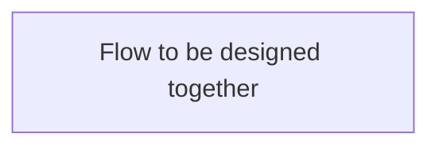
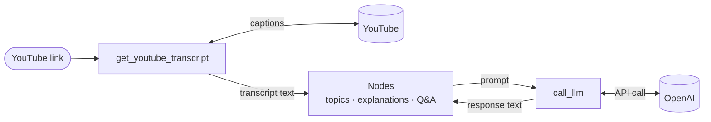
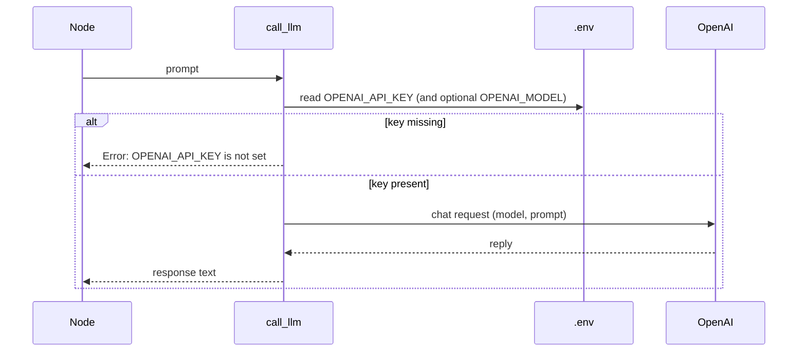

# Design Doc: YouTube Video Study Guide

> Please DON'T remove notes for AI

## Requirements

> Notes for AI: Keep it simple and clear.
> If the requirements are abstract, write concrete user stories

A learner pastes a YouTube link and wants a **simple study guide** they can actually use — not a long recap they still have to watch the video to understand.

### User stories

1. **Paste a link.** I paste a YouTube URL. The system uses that video as the only source of truth.
2. **See the topics.** I get a short list of the **key topics** the video actually covers (not a dump of every tangent).
3. **Understand each topic simply.** For each topic I get a **plain-language explanation** — as if teaching a smart beginner. No jargon unless the video depends on it, and then it is explained.
4. **Study with Q&A.** For each topic I get a few **questions and answers** grounded in the video, so I can check that I understood it.
5. **Test myself.** I can switch to a **test mode**: one question at a time on a card. I see the question first, then flip to see the answer on the back.

### Success looks like

- I can go from **link → topics + simple explanations + Q&A** without watching the whole video.
- Explanations feel **simple**, not academic.
- Test mode only shows **questions from this video**, one card at a time, answer hidden until I flip.

### Explicit non-goals (v1)

- No downloading or transcribing audio. **Captions/transcript only.**
- No accounts, history, or saving study guides across sessions (unless we add that later).
- No recommending other videos, quizzes with scoring, or spaced repetition.
- No multi-language UI. Use the transcript language as-is; explanations in the same language as the video when possible.

### Assumptions to confirm

- Input is a **single YouTube URL** per run (watch, `youtu.be`, shorts, or embed).
- If there is **no caption track**, we stop with a clear failure — we do not fall back to Whisper/audio.
- **LLM work** (topics, explanations, Q&A) is *not* a utility; it lives in nodes later.
- Test-mode **cards** come after the study guide is generated. UI (CLI vs simple local page) is decided when we design the flow.

## Flow Design

> Notes for AI:
> 1. Consider the design patterns of agent, map-reduce, rag, and workflow. Apply them if they fit.
> 2. Present a concise, high-level description of the workflow.

**Paused on purpose.** Next step together: pick a pattern (likely a simple **workflow**, maybe **map-reduce** if the transcript is long) and sketch nodes.

### Applicable Design Pattern:

_(to design together)_

### Flow high-level Design:

_(to design together)_

## Utility Functions

> Notes for AI:
> 1. Understand the utility function definition thoroughly by reviewing the doc.
> 2. Include only the necessary utility functions, based on nodes in the flow.
> 3. Avoid try/except in utilities; let Node retries handle failures.
> 4. LLM summarization / Q&A / explanations are NOT utilities.

1. **Call LLM** (`utils/call_llm.py`)
   - *Input*: prompt (str)
   - *Output*: response (str)
   - Provider: OpenAI, default model `gpt-4o-mini` (override with `OPENAI_MODEL`); key read from `OPENAI_API_KEY` in `.env`
   - Used later by nodes that extract topics, write simple explanations, and generate Q&A
   - Necessity: the only way nodes talk to the model

2. **Get YouTube transcript** (`utils/get_youtube_transcript.py`)
   - *Input*: YouTube URL (str)
   - *Output*: plain transcript text (str)
   - Necessity: the study guide must be grounded in what was said in the video; this is the hard external interface

### How the utilities work

The two utilities are the system's only contact with the outside world: YouTube in, the LLM for thinking. Everything else (topics, explanations, Q&A) will live in nodes that call them.

#### Get YouTube transcript

Turns a link into the full text of what was said in the video, in two steps:

1. **Find the video ID.** Every video has an 11-character ID (e.g. `jNQXAC9IVRw`). The utility finds it in any common link shape:

   | Link style | Example | Where the ID is |
   |---|---|---|
   | Watch link | `youtube.com/watch?v=jNQXAC9IVRw` | the `v=` part of the query |
   | Share link | `youtu.be/jNQXAC9IVRw` | the path |
   | Embed / Shorts / Live | `youtube.com/shorts/jNQXAC9IVRw` | second part of the path |
   | Bare ID | `jNQXAC9IVRw` | already the ID |

2. **Fetch and clean the captions.** YouTube returns captions as many small timed snippets. The utility joins them into one string and tidies the whitespace.

Example: snippets `"All right, so here we are,"` + `"in front of the elephants"` become one line, `"All right, so here we are, in front of the elephants ..."`.

**Known limits (v1):** English captions only by default; timestamps are dropped; videos without captions fail (no audio fallback); uncommon hosts like `music.youtube.com` are not recognised.

#### Call LLM

Sends one prompt to OpenAI and returns the reply as text.

- The model defaults to `gpt-4o-mini`. Change it with `OPENAI_MODEL` in `.env` without touching the code.
- Only this file knows which provider is used, so switching provider means changing one file.

#### Shared rules for both utilities

- **No error catching inside utilities.** A failure (network blip, rate limit, missing captions) is raised straight away. The calling node's built-in retry (`max_retries`, `wait`) decides whether to try again, so mistakes surface quickly instead of being hidden.
- **Logging.** Each call logs what it is doing (video ID, transcript length, prompt and response length) to make debugging easier.
- **Self-test.** Running either file directly runs a small check: link parsing plus a real transcript fetch, or a real test prompt to the LLM.

## Node Design

### Shared Store

> Notes for AI: Try to minimize data redundancy

_(to design together after flow)_

### Node Steps

> Notes for AI: Carefully decide whether to use Batch/Async Node/Flow.

_(to design together after flow)_
