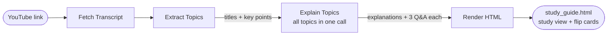
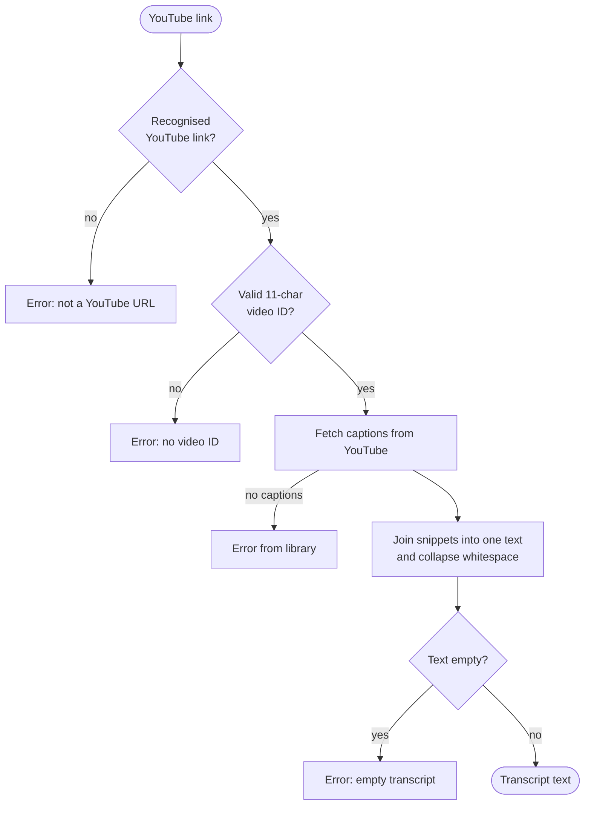
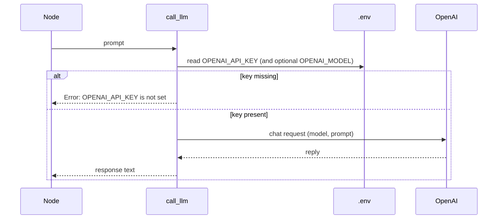

# Design Doc: YouTube Video Study Guide

> Please DON'T remove notes for AI

## Requirements

> Notes for AI: Keep it simple and clear.
> If the requirements are abstract, write concrete user stories

A learner pastes a YouTube link and wants a **simple study guide** they can actually use — not a long recap they still have to watch the video to understand.

### User stories

1. **Paste a link.** I paste a YouTube URL. The system uses that video as the only source of truth.
2. **See the topics.** I get a short list of the **key topics** the video actually covers (not a dump of every tangent).
3. **Understand each topic simply.** For each topic I get a **plain-language explanation** — as if teaching a smart beginner. No jargon unless the video depends on it, and then it is explained.
4. **Study with Q&A.** For each topic I get a few **questions and answers** grounded in the video, so I can check that I understood it.
5. **Test myself.** I can switch to a **test mode**: one question at a time on a card. I see the question first, then flip to see the answer on the back. I mark each card **Got it** or **Missed it**, see my score at the end, and can retry just the ones I missed.

### Success looks like

- I can go from **link → topics + simple explanations + Q&A** without watching the whole video.
- Explanations feel **simple**, not academic.
- Test mode only shows **questions from this video**, one card at a time, answer hidden until I flip.

### Explicit non-goals (v1)

- No downloading or transcribing audio. **Captions/transcript only.**
- No accounts, history, or saving study guides across sessions (unless we add that later).
- No recommending other videos or spaced repetition. Scores are not saved between sessions.
- No multi-language UI. Use the transcript language as-is; explanations in the same language as the video when possible.

### Decisions (defaults, change if needed)

- Input is a **single YouTube URL** per run (watch, `youtu.be`, shorts, embed, or live).
- If there is **no caption track**, we stop with a clear failure. No fallback to Whisper/audio.
- **LLM work** (topics, explanations, Q&A) is *not* a utility; it lives in nodes.
- **Size of the guide:** 3–7 key topics, each with exactly 3 specific question/answer pairs (one clear answer each, no generic "why is X important" questions).
- **Long videos:** the whole transcript goes into one prompt. An hour of speech is roughly 10k words (~13k tokens), well inside the model's context window, so no chunking in v1. Map-reduce is the upgrade path if we hit the limit.
- **Frontend, step 1:** the flow writes a single self-contained `study_guide.html` (study view + flip-card test mode). No server.
- **Frontend, step 2 (later):** a small FastAPI server runs the same flow so people can paste a link in the browser. Needed because the API key must stay secret and the pipeline is Python.

## Flow Design

> Notes for AI:
> 1. Consider the design patterns of agent, map-reduce, rag, and workflow. Apply them if they fit.
> 2. Present a concise, high-level description of the workflow.

### Applicable Design Pattern:

1. **Workflow:** a fixed chain of steps (fetch → topics → explain → render). The task is well defined, so no agent decisions are needed.
2. **One call for all topics (not batch):** all explanations and Q&A are written in a single call that sees every topic at once. We first tried a batch (one call per topic), but each call picked the video's most memorable facts, so the same question appeared under several topics. One call can see every question and keep them all different.
3. **Structured output:** LLM steps reply in YAML and are validated, so a malformed reply triggers the node's retry.

Not used: **map-reduce** (transcripts fit in one prompt), **RAG** (one video, no search needed), **agent** (no open-ended decisions).

### Flow high-level Design:

1. **Fetch Transcript:** turns the YouTube link into transcript text.
2. **Extract Topics:** reads the transcript and picks the 3–7 key topics, each with a title, a one-line summary and 2–4 key points. Each key point belongs to exactly one topic, which sets clear boundaries between topics.
3. **Explain Topics:** in one call, writes a plain-language explanation and 3 Q&A pairs for every topic, taken from that topic's key points, with no question repeated across the guide.
4. **Render HTML:** writes one HTML page with the study guide and a flip-card test mode. No LLM.



**LLM calls per video:** 2 (topics, then explanations + Q&A). Default model `gpt-5.4-mini` (best quality of the models we compared: `gpt-4o-mini`, `gpt-4o`, `gpt-5.4-mini`).

## Utility Functions

> Notes for AI:
> 1. Understand the utility function definition thoroughly by reviewing the doc.
> 2. Include only the necessary utility functions, based on nodes in the flow.
> 3. Avoid try/except in utilities; let Node retries handle failures.
> 4. LLM summarization / Q&A / explanations are NOT utilities.

1. **Call LLM** (`utils/call_llm.py`)
   - *Input*: prompt (str)
   - *Output*: response (str)
   - Provider: OpenAI, default model `gpt-5.4-mini` (override with `OPENAI_MODEL`); key read from `OPENAI_API_KEY` in `.env`
   - Used later by nodes that extract topics, write simple explanations, and generate Q&A
   - Necessity: the only way nodes talk to the model

2. **Get YouTube transcript** (`utils/get_youtube_transcript.py`)
   - *Input*: YouTube URL (str)
   - *Output*: plain transcript text (str)
   - Necessity: the study guide must be grounded in what was said in the video; this is the hard external interface

### How the utilities work

The two utilities are the system's only contact with the outside world: YouTube in, the LLM for thinking. Everything else (topics, explanations, Q&A) will live in nodes that call them.


#### Get YouTube transcript

Turns a link into the full text of what was said in the video, in two steps:

1. **Find the video ID.** Every video has an 11-character ID (e.g. `jNQXAC9IVRw`). The utility finds it in any common link shape:

   | Link style | Example | Where the ID is |
   |---|---|---|
   | Watch link | `youtube.com/watch?v=jNQXAC9IVRw` | the `v=` part of the query |
   | Share link | `youtu.be/jNQXAC9IVRw` | the path |
   | Embed / Shorts / Live | `youtube.com/shorts/jNQXAC9IVRw` | second part of the path |
   | Bare ID | `jNQXAC9IVRw` | already the ID |

2. **Fetch and clean the captions.** YouTube returns captions as many small timed snippets. The utility joins them into one string and tidies the whitespace.



Example: snippets `"All right, so here we are,"` + `"in front of the elephants"` become one line, `"All right, so here we are, in front of the elephants ..."`.

**Known limits (v1):** English captions only by default; timestamps are dropped; videos without captions fail (no audio fallback); uncommon hosts like `music.youtube.com` are not recognised.

#### Call LLM

Sends one prompt to OpenAI and returns the reply as text.



- The model defaults to `gpt-5.4-mini`. Change it with `OPENAI_MODEL` in `.env` without touching the code.
- Only this file knows which provider is used, so switching provider means changing one file.

#### Shared rules for both utilities

- **No error catching inside utilities.** A failure (network blip, rate limit, missing captions) is raised straight away. The calling node's built-in retry (`max_retries`, `wait`) decides whether to try again, so mistakes surface quickly instead of being hidden.
- **Logging.** Each call logs what it is doing (video ID, transcript length, prompt and response length) to make debugging easier.
- **Self-test.** Running either file directly runs a small check: link parsing plus a real transcript fetch, or a real test prompt to the LLM.

## Node Design

### Shared Store

> Notes for AI: Try to minimize data redundancy

Each topic is one dict that later nodes fill in, so nothing is stored twice.

```python
shared = {
    "url": "https://www.youtube.com/watch?v=...",  # input
    "transcript": "full caption text ...",         # Fetch Transcript
    "topics": [                                    # Extract Topics creates title, summary, key points
        {
            "title": "What a neural network is",
            "summary": "One-line description of the topic",
            "key_points": ["Specific point, only in this topic"],  # Extract Topics
            "explanation": "Plain-language explanation",   # Explain Topics adds
            "questions": [                                 # Explain Topics adds
                {"question": "...", "answer": "..."},
            ],
        },
    ],
    "output_path": "study_guide.html",             # Render HTML
}
```

### Node Steps

> Notes for AI: Carefully decide whether to use Batch/Async Node/Flow.

1. **Fetch Transcript**
   - *Purpose*: get the text the whole guide is grounded in
   - *Type*: Regular (retries for network blips)
   - *Steps*:
     - *prep*: read `url`
     - *exec*: call `get_youtube_transcript`
     - *post*: write `transcript`

2. **Extract Topics**
   - *Purpose*: pick the key topics the video actually covers, skipping tangents
   - *Type*: Regular (retries on a malformed reply)
   - *Steps*:
     - *prep*: read `transcript`
     - *exec*: call `call_llm` asking for 3–7 non-overlapping topics as YAML (title, summary, 2–4 key points that appear under one topic only), in the video's language; check it parses and every topic has a title and key points
     - *post*: write `topics` (title, summary, key points)

3. **Explain Topics**
   - *Purpose*: make each topic easy to understand and testable
   - *Type*: Regular (one call for all topics, so no question repeats across topics)
   - *Steps*:
     - *prep*: read `transcript` and `topics`
     - *exec*: call `call_llm` once with every topic and its key points, asking for a beginner-friendly explanation and exactly 3 specific Q&A pairs per topic as YAML, using only what the video says; check there is one entry per topic, each with an explanation and exactly 3 questions
     - *post*: add `explanation` and `questions` to each dict in `topics`

4. **Render HTML**
   - *Purpose*: turn the study guide into one page the learner can open
   - *Type*: Regular (no LLM)
   - *Steps*:
     - *prep*: read `url` and `topics`
     - *exec*: call `render_study_guide` to build the page
     - *post*: save the file and write `output_path`

### Render utility (step 1 frontend)

3. **Render study guide** (`utils/render_study_guide.py`)
   - *Input*: url (str), topics (list of dicts, as in the shared store)
   - *Output*: HTML (str). One self-contained page: topic list with explanations and Q&A, plus a test mode with flip cards (question on the front, answer on the back), Got it / Missed it scoring, a score summary at the end, Retry missed and Shuffle
   - Necessity: writing the output is an external-facing step, kept out of the nodes
